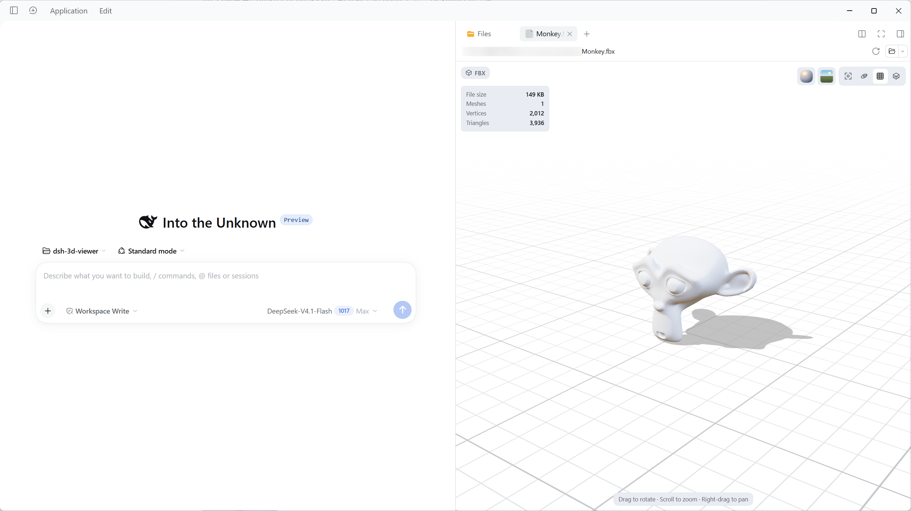

# 3D Viewer

English | [中文](README.zh.md)

Preview FBX, OBJ, glTF, GLB, and STL models from the current session's workspace in DSH's right sidebar. No uploads or network: open a model, orbit, zoom, switch materials and environments, and play embedded animations.

## Installation and enabling

Distributed as the npm package `dsh-3d-viewer`. The prebuilt `client.js` already bundles Three.js, the loaders, and four HDRIs; no Node.js or npm download is needed at runtime, and React comes from DSH.

### Install from npm (recommended)

1. Open DSH Desktop and choose **Plugins** in the sidebar.
2. Click **Add plugin** → **Install a third-party plugin**.
3. Enter `dsh-3d-viewer` (or `dsh-3d-viewer@0.1.0` to pin a version).
4. Set **Registry** to the official npm registry (npmmirror also works in mainland China).
5. Click **Install**, then confirm **3D Viewer** is **On** under **Installed plugins**.
6. Open a model from any session. If no preview appears, refresh the page; if it still does not, restart DSH.

> **Updating**: remove the old version under **Plugins**, then install the new one with a higher version.

### Install from a local directory (optional)

Use this for offline or intranet distribution.

1. Unpack the plugin directory anywhere; it must contain `package.json`, `client.js`, `index.js`, and `cordis.patch.yml`.
2. Open DSH Desktop and choose **Plugins** in the sidebar.
3. Click **Add plugin** → **Install a third-party plugin**.
4. Enter the directory's absolute path (for example `F:\plugins\dsh-3d-viewer`) and click **Install**.
5. Confirm **3D Viewer** is **On** under **Installed plugins**.
6. Open a model from any session. If no preview appears, refresh the page; if it still does not, restart DSH.

> Local installs link to the directory rather than copying it. Do not move, rename, or delete it, or DSH may not find the plugin on the next start.
>
> Plugins run inside the DSH process; install only trusted sources.

### Requirements

- DSH Desktop.
- WebGL 2 support; otherwise the preview reports an error.
- Model files in the session workspace, reachable through **Files** in the right sidebar.

## Open a model

1. Open any session and click the right-sidebar button at the top-right of the conversation.
2. Open **Files** in the sidebar (or press `Mod+P`).
3. Click any `.fbx`, `.obj`, `.gltf`, `.glb`, or `.stl` file.
4. The model opens in a preview tab. Large files and the first environment switch may take a few seconds.

## Supported formats

| Format | Support |
| --- | --- |
| **FBX** | Meshes, hierarchy, materials, embedded textures, animations, and node data |
| **OBJ** | Polygons, `o`/`g` groups, normals, UVs, vertex colors, line/point primitives, `mtllib`/MTL, and common textures |
| **glTF / GLB** | Animations, skinning, embedded resources, and external `.bin` files and textures |
| **STL** | ASCII and binary STL; neutral double-sided PBR material; binary vertex colors preserved |

External resources (FBX/glTF textures, glTF `.bin`, OBJ MTL and textures) are read from the session workspace.

Notes:

- **All formats**: lights, cameras, and audio embedded in the file are removed; the preview uses its own lighting and camera.
- **FBX**: a missing external texture warns but does not block geometry.
- **OBJ**: a missing MTL falls back to default materials; missing textures use white placeholders.
- **glTF / GLB**: resources shared by several primitives are read once.
- **STL**: no materials or animations.

### Not supported

- glTF extensions that need extra decoders: Draco, Meshopt, KTX2.
- Texture formats DSH cannot decode directly: TGA, DDS, EXR, and similar (shown as white placeholders).
- MTL `map_Ks` / `map_Ns` are not fully mapped to PBR yet (`Kd/Ks/Ns/d` and diffuse/normal/bump/emissive/alpha/displacement textures are supported).

## Code structure

| Path | Responsibility |
| --- | --- |
| `src/client.js` | Plugin entry; registers document previews and Sidebar slots per format |
| `src/formats.js` | Format registry: ids, extensions, title/badge keys, and format normalization |
| `src/bytes.js` | Shared byte, text, path, MIME, and base64 helpers plus the cancellation error |
| `src/ui/ModelViewer.js` | Viewer container: loading/error state, format binding, and scene lifecycle |
| `src/ui/ViewerSurface.js` | Pure presentation: toolbar, stats, animation bar, and status overlay; renderable without WebGL |
| `src/ui/AnimationBar.js` | Animation transport; playback state and 30 Hz progress updates re-render only this small component |
| `src/ui/chrome.js`, `icons.js`, `primitives.js` | Toolbar, data-driven material/environment popovers, stats panel, icons, and formatting |
| `src/ui/styles.js`, `dictionaries.js`, `options.js` | Styles, English/Chinese copy, and UI options |
| `src/scene/createSceneView.js` | Scene orchestration: renderer, camera, controls, lifecycle |
| `src/scene/environment.js` | HDRI decoding, PMREM construction, and environment map caching |
| `src/scene/materials.js` | Phong/Lambert → PBR conversion, material presets, and wireframe material |
| `src/scene/ground.js` | Infinite grid shader and shadow receiver; grid pixels are generated once per page |
| `src/scene/animation.js` | AnimationMixer, clip timeline, and progress notifications |
| `src/scene/camera.js`, `lighting.js`, `render-loop.js`, `postprocessing.js`, `blue-noise.js` | Framing and keyboard orbit, lighting, frame scheduling, MSAA/ACES post-processing, and blue-noise dithering |
| `src/loaders/workspace.js` | `resourceAddress` parsing, workspaceFiles reads, absolute-path fallback, texture Blob/white fallback, and resource cleanup |
| `src/loaders/model-loader.js` | Async FBX / OBJ / glTF / GLB / STL loading and table-driven format dispatch |
| `src/loaders/gltf.js` | glTF/GLB external buffer/texture prefetch (deduplicated by resource), animation wiring, and cleanup |
| `src/model.js` | Synchronous FBX / OBJ / STL parsing, stats, and resource disposal |
| `src/vendor/FBXLoaderPbr.js` | Vendored Three.js FBXLoader with metalness/roughness custom-attribute support |
| `src/generated/hdri-data.js` | Generated embedded HDRI data; do not edit by hand |
| `tests/run.mjs` | Test entry; each `tests/*.mjs` runs in its own process |
| `icon.svg` | Plugin icon; DSH metadata requires it at the package root |
| `assets/hdri/` | HDRI source files |

## License

MIT; see [LICENSE](LICENSE). Third-party notices are in [THIRD_PARTY_NOTICES.md](THIRD_PARTY_NOTICES.md), including Three.js (MIT) and Poly Haven HDRIs (CC0; see [assets/hdri/LICENSE.md](assets/hdri/LICENSE.md)). React is provided by DSH and is not distributed with this package.
