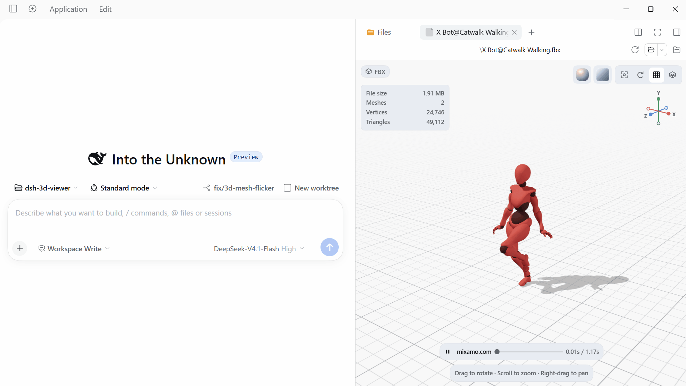

<div align="center">
  
  <h1 align="center">3D Viewer</h1>
</div>

[English](https://github.com/ybniaobu/dsh-3d-viewer/blob/main/README.md) | 中文

[](https://github.com/ybniaobu/dsh-3d-viewer) [](https://www.npmjs.com/package/dsh-3d-viewer?activeTab=readme)

在 DSH 右侧边栏预览会话工作区中的 3D 模型和纹理。支持 FBX、OBJ、glTF、GLB、DAE、STL 模型，以及 PNG、JPEG、TGA、EXR、HDR 纹理。可旋转，缩放，切换视角、材质与环境，并播放内嵌动画。



## 安装

插件通过 npm 包 `dsh-3d-viewer` 分发。Three.js 运行时与格式解码器只在打开预览时加载。

### 从 npm 安装（推荐）

1. 打开 DSH Desktop，点击侧边栏的 **Plugins（插件）**。
2. 点击 **Add plugin（添加插件）** → **Install a third-party plugin（安装第三方插件）**。
3. 输入 `dsh-3d-viewer`，需要固定版本时写 `dsh-3d-viewer@0.3.0`。
4. **Registry** 选择 npm 官方源（国内也可用 npmmirror）。
5. 点击 **Install**，在 **Installed plugins（已安装插件）** 中确认 **3D Viewer** 为 **On**。

### 从本地目录安装（可选）

1. 把插件目录解压到任意位置。
2. 打开 DSH Desktop，点击侧边栏的 **Plugins（插件）**。
3. 点击 **Add plugin（添加插件）** → **Install a third-party plugin（安装第三方插件）**。
4. 填入插件目录的绝对路径（例如 `F:\plugins\dsh-3d-viewer`），点击 **Install**。
5. 在 **Installed plugins（已安装插件）** 中确认 **3D Viewer** 为 **On**。

插件代码在 DSH 进程中运行，请只安装可信来源。

### 运行要求

- DSH Desktop 0.2.2-rc.3 或更高版本。
- 支持 WebGL 2。
- 模型或纹理位于会话工作区。

## 使用

打开右侧边栏，进入 **Files**（`Mod+P`），点击支持的文件。

**模型预览**：拖拽旋转，滚轮缩放，右键拖拽平移。工具栏可复位视角、自动旋转，以及切换网格和线框；点击或拖动坐标轴切换视角；材质和环境选择器位于右上角。模型包含动画片段时，底部提示上方会显示动画栏：可播放/暂停、按名称选择片段、拖动进度条跳转，并选择 `0.5×` 到 `2×` 的播放速度。切换片段会回到该片段第一帧，同时保持当前播放/暂停状态。

**纹理预览**：滚轮缩放，放大后拖拽平移；使用 **适应窗口** 或双击复位；**垂直翻转** 用于处理上下颠倒的源图。元信息显示尺寸、位深和缩放比例。

大文件和首次切换环境可能需要几秒。没有预览时先刷新页面，再重启 DSH。

## 支持格式

### 模型预览

| 格式 | 支持内容 |
| --- | --- |
| **FBX** | 网格、层级、材质、内嵌贴图、动画、节点数据 |
| **OBJ** | 多边形、分组、法线、UV、顶点色、线/点、MTL、常用贴图 |
| **glTF / GLB** | 动画、蒙皮、内嵌资源、外部 `.bin` 与贴图 |
| **DAE** | COLLADA 网格、材质、外部贴图与动画 |
| **STL** | ASCII/二进制、中性 PBR 材质、二进制顶点色 |

说明：

- 忽略模型自带的灯光、相机和音频。
- 外部贴图从工作区读取。
- FBX 外部贴图缺失时只告警。
- OBJ 缺少 MTL 时使用默认材质，贴图缺失时使用白色占位。
- glTF/GLB 的外部 `.bin` 和贴图必须存在于工作区，缺失会导致资源加载失败。
- glTF 的 Draco、Meshopt、KTX2 扩展不支持。
- DDS、KTX2、PVR 等无内置解码器的格式不支持。
- MTL 的 `map_Ks` / `map_Ns` 尚未完整映射到 PBR。
- STL 没有材质和动画。

### 纹理预览

| 格式 | 解码数据 | 预览 |
| --- | --- | --- |
| **PNG** | 8-bit RGBA | 直接显示，保留 alpha |
| **JPG / JPEG** | 8-bit RGBA | 直接显示，保留 alpha |
| **TGA** | 8-bit RGBA | 直接显示，保留 alpha |
| **EXR** | 16-bit half 或 32-bit float，1–4 通道 | 色调映射到 SDR |
| **HDR** | Radiance RGBE，默认 16-bit half | 色调映射到 SDR |

- EXR、HDR 使用曝光 1 和 Reinhard 色调映射后输出 sRGB。
- HDR 预览在支持 WebGL2 时使用 GPU 色调映射，否则回退到 half-float CPU 路径。
- 预览按资源地址、版本和格式缓存（普通 160 MiB，低内存 64 MiB）。

## 代码结构

| 区域 | 主要文件 |
| --- | --- |
| 宿主与打包 | `index.js`、`cordis.patch.yml`、`package.json` |
| 核心 | `src/core/`：字节工具、格式注册、模型统计 |
| 客户端注册 | `src/client.js`、`src/core/formats.js`、`src/core/texture-formats.js` |
| 懒加载运行时 | `src/runtime.js`、`src/ui/viewer-runtime.js`、`src/loaders/address.js` |
| 懒加载 UI chunk | `client.ui.styles.js`、`client.ui.texture.js`、`client.locales.*.js` |
| UI | `src/ui/`：框架、控件、偏好；`ui/model/` 与 `ui/texture/` 分别为两个查看器 |
| 场景 | `src/scene/`：渲染器、相机、材质、环境、网格、后处理 |
| 加载器 | `src/loaders/`：格式分派、工作区读取、纹理 Worker，`formats/` 为格式加载器 |
| 第三方代码 | `src/vendor/`：修改过的 FBX Loader |
| 构建与测试 | `build.mjs`、`tests/run.mjs`、`tests/**/*.mjs` |

`src/client.js` 只负责注册预览；`src/runtime.js` 持有 Three.js、场景初始化和格式懒加载分派。UI 入口不直接导入 Three.js；场景代码和纹理 WebGL 预览随懒加载运行时加载。样式、非中英文语言字典和纹理查看器同样是包内 UI chunk；中英文字典保留在入口中，作为 DSH 的回退语言。

## 开发

```sh
npm ci
npm test
npm run build
```

CI 使用 Node.js 24。`npm test` 会让每个 `tests/**/*.mjs` 在独立进程中运行。

`npm run build` 会写出 UI 入口、懒加载运行时、格式/纹理 chunk、UI 样式/语言/纹理 chunk 和 EXR/HDR Worker 到 `dist/`。修改源码后需提交重建的 `dist/` 文件。

## 许可证

MIT，见 [LICENSE](https://github.com/ybniaobu/dsh-3d-viewer/blob/main/LICENSE)。第三方声明见 [THIRD_PARTY_NOTICES.md](https://github.com/ybniaobu/dsh-3d-viewer/blob/main/THIRD_PARTY_NOTICES.md)，包括 Three.js（MIT）与 Poly Haven HDRI（CC0）。React 由 DSH 提供。
