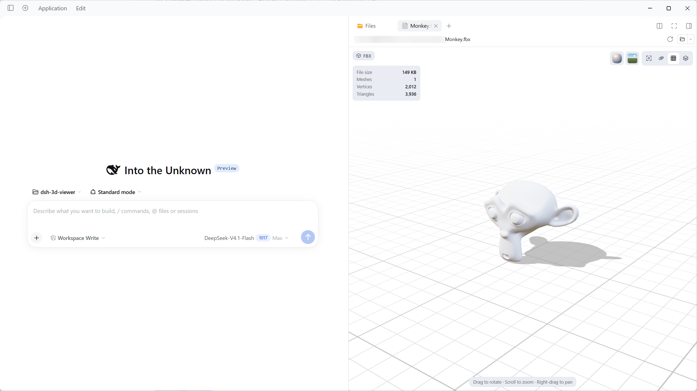

  
  <h1 align="center">3D Viewer</h1>

[English](https://github.com/ybniaobu/dsh-3d-viewer/blob/main/README.md) | 中文

 

在 DSH 右侧边栏预览当前会话工作区里的 FBX、OBJ、glTF、GLB、STL 模型，以及 TGA、EXR、HDR 纹理。打开模型即可旋转、缩放、自动旋转、切换材质与环境，并播放内置动画。

## 安装与启用

插件通过 npm 包 `dsh-3d-viewer` 分发。包内 `dist/client.js` 包含查看器与 Three.js 核心；模型 Loader 与 TGA、EXR、HDR 解码器都是包内懒加载 chunk，只在首次使用时加载。四张 HDRI 随包分发，由只读宿主路由从本机 DSH 服务器提供。React 由 DSH 提供。

### 从 npm 安装（推荐）

1. 打开 DSH Desktop，点击侧边栏的 **Plugins（插件）**。
2. 点击 **Add plugin（添加插件）** → **Install a third-party plugin（安装第三方插件）**。
3. 输入 `dsh-3d-viewer`；需要固定版本时写 `dsh-3d-viewer@0.2.0`。
4. **Registry** 选择 npm 官方源（国内也可用 npmmirror）。
5. 点击 **Install**，在 **Installed plugins（已安装插件）** 中确认 **3D Viewer** 为 **On**。

> **更新**：先在 **Plugins** 中移除旧版本，再安装更高版本的新包。

### 从本地目录安装（可选）

适合离线或内网分发。

1. 把插件目录解压到任意位置，目录需包含 `package.json`、`dist/client.js` 及其 chunks、`index.js`、`cordis.patch.yml` 和 `assets/hdri/` 目录。
2. 打开 DSH Desktop，点击侧边栏的 **Plugins（插件）**。
3. 点击 **Add plugin（添加插件）** → **Install a third-party plugin（安装第三方插件）**。
4. 填入插件目录的绝对路径（例如 `F:\plugins\dsh-3d-viewer`），点击 **Install**。
5. 在 **Installed plugins（已安装插件）** 中确认 **3D Viewer** 为 **On**。

> 本地安装以链接方式引用目录，安装后不要移动、重命名或删除它，否则 DSH 下次启动可能找不到插件。
>
> 插件代码在 DSH 进程中运行，请只安装可信来源。

### 运行要求

- DSH Desktop 0.2.2-rc.1 或更高版本（在 0.2.2-rc.1 上构建和测试）。
- 支持 WebGL 2，否则预览会报错。
- 模型和纹理文件位于会话工作区内，可通过右侧边栏的 **Files** 打开。

## 打开模型或纹理

在任意会话中打开右侧边栏，再打开 **Files**（`Mod+P`），点击 `.fbx`、`.obj`、`.gltf`、`.glb`、`.stl`、`.tga`、`.exr` 或 `.hdr` 文件，即可在预览标签中打开。大文件和第一次切换环境可能需要几秒钟。

若没有出现预览，先刷新页面；仍未出现时重启 DSH。

## 支持的文件格式

| 格式 | 支持内容 |
| --- | --- |
| **FBX** | 网格、层级、材质、内嵌贴图、动画、节点数据 |
| **OBJ** | 多边形、`o`/`g` 分组、法线、UV、顶点色、线与点图元、`mtllib`/MTL、常用贴图 |
| **glTF、GLB** | 动画、蒙皮、内嵌资源、外部 `.bin` 与贴图 |
| **STL** | ASCII 与二进制 STL；中性双面 PBR 材质；保留二进制顶点色 |
| **TGA、EXR、HDR** | 独立纹理预览，以及 FBX、OBJ 的 sidecar 贴图；见下方 [纹理预览](#纹理预览) |

外部资源（FBX、glTF 贴图、glTF `.bin`、OBJ MTL 与贴图）均从会话工作区读取。

补充说明：

- **所有格式**：文件自带的灯光、相机和音频节点会被移除，预览统一使用自己的灯光和相机。
- **FBX**：外部贴图缺失时仅告警，不阻断几何显示。
- **OBJ**：缺少 MTL 时回退默认材质；贴图缺失时使用白色占位。
- **glTF、GLB**：多个图元共用的资源只读取一次。
- **STL**：没有材质和动画。

### 纹理预览

TGA、EXR、HDR 文件可以直接从 **Files** 打开；同一套解码器也用于 FBX、OBJ 的外部贴图引用。

| 格式 | 解码数据 | 预览行为 |
| --- | --- | --- |
| **TGA** | 8-bit RGBA（RGBA8） | 直接显示像素数据，保留 alpha。 |
| **EXR** | 16-bit half float 或 32-bit float，1–4 通道 | 线性 HDR 数据经色调映射后显示。 |
| **HDR** | Radiance RGBE，默认解码为 16-bit half float | 线性 HDR 数据经色调映射后显示。 |

- EXR、HDR 预览使用曝光 1 和 Reinhard 色调映射，再输出 sRGB；材质渲染仍使用线性值。
- 元信息显示尺寸、每通道位深和当前缩放比例。
- 独立预览支持滚轮缩放、放大后拖拽平移、**适应窗口** / 双击复位，以及 **垂直翻转**。
- 解码 chunk 只在首次使用时加载；打开 PNG、JPEG 或不使用 TGA、EXR、HDR 的模型不会下载它们。

### 暂不支持

- 需要额外解码器的 glTF 扩展：Draco、Meshopt、KTX2。
- 暂无内置解码器的贴图格式：DDS、KTX2、PVR 等（显示白色占位）。
- MTL 的 `map_Ks` / `map_Ns` 尚未完整映射到 PBR（`Kd/Ks/Ns/d` 和 diffuse/normal/bump/emissive/alpha/displacement 贴图已支持）。

## 代码结构

### 宿主与打包

| 路径 | 职责 |
| --- | --- |
| `index.js` | 宿主端：注册只读的 `/dsh-3d-viewer/hdri` 路由 |
| `cordis.patch.yml` | 插入插件行的 bundle patch |
| `package.json` | DSH manifest、exports、engines 和打包文件列表 |
| `dist/client.js` | 预构建客户端入口，经 `exports["./client"]` 提供 |
| `dist/client.*.js` | FBX、OBJ、glTF、GLB、STL 与 TGA、EXR、HDR 懒加载 chunk，与入口同目录 |
| `icon.svg` | DSH 元信息要求的包根图标 |
| `locale/*.json` | 中英文 UI 字典 |
| `assets/hdri/` | 由宿主路由提供的 Poly Haven CC0 HDRI |

### 客户端入口与共享数据

| 路径 | 职责 |
| --- | --- |
| `src/client.js` | 按格式注册 document preview 与 Sidebar slot |
| `src/formats.js` | 模型格式 id、扩展名、标题与归一化 |
| `src/texture-formats.js` | 独立纹理格式的 id、扩展名与标题 |
| `src/bytes.js` | 字节、文本、路径、MIME、base64 辅助与取消错误 |
| `src/model.js` | 模型统计、内嵌节点剥离与资源释放 |

### UI

| 路径 | 职责 |
| --- | --- |
| `src/ui/model-viewer.js` | 渲染体容器：加载生命周期、设置与状态 |
| `src/ui/viewer-surface.js` | 纯展示：工具条、统计、动画条与状态浮层 |
| `src/ui/texture-viewer.js` | TGA、EXR、HDR 独立纹理预览、色调映射、滚轮缩放、拖拽平移与垂直翻转 |
| `src/ui/animation-bar.js` | 动画播放控制与进度更新 |
| `src/ui/chrome.js` | 工具条、材质/环境弹层与统计面板 |
| `src/ui/primitives.js` | 共用小组件 |
| `src/ui/icons.js` | 内联图标 |
| `src/ui/styles.js` | 作用域样式 |
| `src/ui/dictionaries.js` | 中英文案 |
| `src/ui/options.js` | 材质/环境选项元数据 |

### 场景

| 路径 | 职责 |
| --- | --- |
| `src/scene/create-scene-view.js` | 场景编排：renderer、camera、controls、渲染循环 |
| `src/scene/renderer.js` | Renderer 创建与固定的 Three 设置 |
| `src/scene/renderer-pool.js` | 跨视图复用 renderer 与 PMREM |
| `src/scene/environment.js` | HDRI 获取、PMREM 构建与按 id 缓存 |
| `src/scene/materials.js` | Phong/Lambert → PBR、材质预设与线框 |
| `src/scene/ground.js` | 无限网格 shader 与阴影接收面 |
| `src/scene/animation.js` | AnimationMixer、片段时间轴与进度 |
| `src/scene/camera.js` | 取景、键盘旋转与裁剪面 |
| `src/scene/lighting.js` | 主/补光与阴影 |
| `src/scene/render-loop.js` | 合并帧调度 |
| `src/scene/postprocessing.js` | MSAA/ACES 与抖动 |
| `src/scene/blue-noise.js` | 蓝噪声贴图 |
| `src/scene/viewer-error.js` | 类型化预览错误 |

### 加载器与 chunks

| 路径 | 职责 |
| --- | --- |
| `src/loaders/model-loader.js` | 懒加载 chunk 分派与格式加载 |
| `src/loaders/fbx.js` | FBX 解析与贴图 sidecar |
| `src/loaders/obj.js` | OBJ 解析与 MTL/贴图解析 |
| `src/loaders/stl.js` | STL 解析 |
| `src/loaders/gltf.js` | glTF、GLB buffer、贴图、动画与清理 |
| `src/loaders/workspace.js` | 资源地址、工作区读取、TGA、EXR、HDR 分派与贴图回退 |
| `src/loaders/chunk-require.js` | DSH 包 chunk 的 `require.async` 桥 |
| `src/loaders/three-bridge.js` | 与懒加载 chunk 共享的 Three 导出 |
| `src/loaders/chunks/*.js` | 每个懒加载格式/纹理 chunk 一个入口 |
| `src/vendor/fbx-loader-pbr.js` | vendored Three FBXLoader，额外支持 PBR 自定义属性 |

### 构建与测试

| 路径 | 职责 |
| --- | --- |
| `build.mjs` | 构建 `dist/client.js`、格式 chunk 与纹理 chunk |
| `tests/run.mjs` | 每个 `tests/*.mjs` 在独立进程中运行 |
| `tests/*.mjs` | loader、renderer pool、HDRI 路由、SSR、manifest、chunks 与纹理预览 |

命名规范：源码文件用 `kebab-case`；React 组件和类用 `PascalCase`；函数和变量用 `camelCase`；模块常量用 `UPPER_SNAKE_CASE`。vendored loader 的内部实现保留上游命名。

## 许可证

MIT，见 [LICENSE](https://github.com/ybniaobu/dsh-3d-viewer/blob/main/LICENSE)。第三方声明见 [THIRD_PARTY_NOTICES.md](https://github.com/ybniaobu/dsh-3d-viewer/blob/main/THIRD_PARTY_NOTICES.md)，包括 Three.js（MIT）与 Poly Haven HDRI（CC0，见 [assets/hdri/LICENSE.md](https://github.com/ybniaobu/dsh-3d-viewer/blob/main/assets/hdri/LICENSE.md)）。React 由 DSH 提供，不随包分发。
